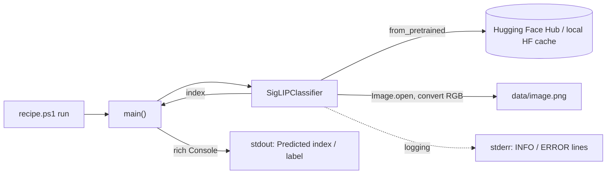

# siglipv2 - documentation hub

`siglipv2` is a single Python script, `classify_siglip.py`, that classifies one image zero-shot: it scores the image against a list of text labels with the Hugging Face model `google/siglip2-base-patch16-224` and prints the index and text of the label with the highest score (`classify_siglip.py:25-74`). No model is trained or fine-tuned (`README.md:3`). The intended audience is not stated in the repository; commit `7efb2d1` removed a course brief, which suggests (inference) that the project began as a course exercise.

The requirements reverse-engineered from the code are in [`../SPEC.md`](../SPEC.md).

## Status

- Last change to the classifier code: `classify_siglip.py` on 2026-08-05 (commit `60f3234`). Tests, `pyproject.toml`, `uv.lock` and the docs were last changed on 2026-11-08 (commits `ef7a096`, `2aefb8e`, `b5c0362`). `HEAD` of `release` is `bd514f2`, 2026-11-08.
- Tests: 10 pytest tests in `tests/`, run with a fake model and processor, so no weights are downloaded (`tests/test_classify_siglip.py`, `tests/conftest.py:6`).
- CI: five Gitea Actions workflows in `.gitea/workflows/` that call or read `recipe.ps1` on a runner labelled `windows` (`.gitea/workflows/propose.yaml:14`). Whether a runner actually serves this repository is not recorded (`CLAUDE.md`, paragraph after rule 8).
- Evidently unfinished or open: the image, labels and model are hard-coded and the script takes no options (`classify_siglip.py:64-66`, `README.md:13`); the manual-test list is empty (`tests/manual/tests.json:3`); five deviations from the lab requirements are tracked as issues #7-#11 (`README.md:21`).

## Layout

| Path | What it is |
| --- | --- |
| `classify_siglip.py` | All project code: `Classifier` protocol, `SigLIPClassifier`, `main()` (81 lines). |
| `data/image.png` | The input image `main()` classifies; PNG 1920x1440 RGB, stored in Git LFS (`.gitattributes:9`). |
| `tests/test_classify_siglip.py` | Unit tests of the classifier and `main()` with fakes of the model and processor. |
| `tests/conftest.py` | Sets `HF_HUB_OFFLINE=1` before anything imports `huggingface_hub`. |
| `tests/test_no_weights_are_downloaded.py` | Asserts the hub is offline for the whole run. |
| `tests/manual/tests.json` | List of manual tests (currently empty), checked by `tests/test_manual_list.py`. |
| `docs/install.md` | Installation steps. |
| `docs/manual.md` | What a run prints and how to change its inputs. |
| `pyproject.toml` | Package metadata, pinned dependencies, pytest/coverage/mypy/ruff settings. |
| `uv.lock` | uv lock file for Python 3.13 (`uv.lock:3`). |
| `recipe.ps1` | The verbs `build`, `run`, `test`, etc. (see Repository tooling). |
| `.agent/` | Vendored "Antigravity Kit" agent prompts, rules and scripts for C++ and Python (`.agent/ARCHITECTURE.md:1-3`); not project code, excluded from ruff and coverage (`pyproject.toml:57`, `pyproject.toml:82`). |

## Architecture

One module, three parts (`classify_siglip.py`):

- `Classifier` (`:16-17`) - a `typing.Protocol` with `classify(image_path, labels) -> int`. Nothing in the code is typed against it.
- `SigLIPClassifier` (`:20-59`) - picks `cuda` when `torch.cuda.is_available()` and `cpu` otherwise, loads the model with `transformers.AutoModel` and the processor with `AutoProcessor`; `classify()` builds the prompt `This is a photo of <label>.` for each label, opens the image with Pillow as RGB, runs the model under `torch.no_grad()` and returns the arg-max of `logits_per_image`.
- `main()` (`:62-77`) - fixed inputs, prints the result with `rich`, turns any exception into a logged error.



External dependency at run time: the Hugging Face Hub, from which `transformers` downloads the model weights on the first run into the Hugging Face cache (`docs/install.md:9`). The script writes no files of its own (inference: no file-writing call in `classify_siglip.py`).

## Build and run

Prerequisites:

- Python 3.13: `requires-python = ">=3.13,<3.14"` (`pyproject.toml:21`); the lock is for 3.13 only (`uv.lock:3`, `docs/install.md:3`).
- uv; its version is not pinned in the project (`recipe.ps1:16` says only that uv is on the machine).
- Git LFS, because `data/image.png` is stored in it (`docs/install.md:4`).
- PowerShell for `recipe.ps1` (inference from the file type).
- Network access on the first run, to download the model (`docs/install.md:9`).

| Step | Command | Source |
| --- | --- | --- |
| Install dependencies | `uv sync --frozen` | `docs/install.md:5` |
| Run | `.\recipe.ps1 run` (runs `uv run --frozen python classify_siglip.py`) | `README.md:10`, `recipe.ps1:60-62` |
| Test, type-check, lint, format | `.\recipe.ps1 test` | `README.md:13`, `recipe.ps1:82-108` |
| Build a wheel into `dist\` | `.\recipe.ps1 build` (runs `uv build --wheel --out-dir dist`) | `docs/install.md:11`, `recipe.ps1:48-50` |

On Windows the locked `torch` is the CPU build from PyPI, so the script runs on the CPU there (`docs/install.md:7`, `pyproject.toml:23-24`). On Linux the lock pulls the CUDA 13 packages as `torch` dependencies (`uv.lock:897-910`).

## Configuration

`classify_siglip.py` reads no command-line arguments and no environment variables. Its inputs are local variables in `main()`:

| Name | Meaning | Value | Source |
| --- | --- | --- | --- |
| `image_path` | Image to classify, relative to the working directory | `data/image.png` | `classify_siglip.py:64` |
| `candidate_labels` | Labels the image is scored against | `a car`, `a bicycle`, `a truck` | `classify_siglip.py:65` |
| `model_name` | Hugging Face model id | `google/siglip2-base-patch16-224` (also the constructor default) | `classify_siglip.py:66`, `:25` |
| logging level | Fixed at import | `INFO`, format `%(levelname)s: %(message)s` | `classify_siglip.py:12` |

Variables used around the script:

| Name | Used by | Meaning | Source |
| --- | --- | --- | --- |
| `HF_HUB_OFFLINE` | tests | Set to `1` so a test that reaches for the weights fails instead of downloading them | `tests/conftest.py:6` |
| `LAB_SHARE` | `recipe.ps1 publish` | Directory the wheel is copied to; the verb exits 1 when it is unset | `recipe.ps1:66-71` |
| `.claude/.env` | `recipe.ps1` | Optional `NAME=value` lines loaded into the environment; an already-set variable wins; the file is gitignored | `recipe.ps1:34-43`, `.gitignore:24` |

## Usage

1. Classify the bundled image: run `.\recipe.ps1 run` from the repository root. The log lines name the model, the device and the image; then two lines are printed, in the form shown in `docs/manual.md:11-14`:

   ```text
   Predicted index: 0
   Predicted label: a car
   ```

   The index counts from 0 in `candidate_labels`; the scores are not printed (`docs/manual.md:16`).
2. Classify another image or other labels: edit `image_path`, `candidate_labels` or `model_name` in `main()` (`docs/manual.md:7`).
3. Use the class from other Python code: construct `SigLIPClassifier(model_name)` and call `classify(image_path, labels)`, which returns an `int` index into `labels` (`classify_siglip.py:25`, `:31`). The repository has no example of this outside the tests.

On any failure (missing image, weights that cannot be fetched) the run logs `An error occurred: <reason>`, prints no prediction and still exits 0 (`docs/manual.md:18`, `classify_siglip.py:76-77`).

## Testing

`.\recipe.ps1 test` runs, in order: a check that `pyproject.toml`'s version equals `$Version`, `pytest`, `mypy`, `ruff check .` and `ruff format .` (in place); the first failure stops it with exit 1 (`recipe.ps1:82-108`). pytest options come from `pyproject.toml:70-76`: `-q --strict-markers --cov --cov-report=term --cov-fail-under=95`, with branch coverage (`pyproject.toml:81`). mypy runs in strict mode on `classify_siglip.py` and `tools/` (`pyproject.toml:87-94`). Note that the verb also sets `git config core.hooksPath .claude/hooks/git` (`recipe.ps1:96`) and may rewrite files through the formatter.

What the tests cover:

| Test file | Covers |
| --- | --- |
| `tests/test_classify_siglip.py` (7 tests) | model and processor loaded by name; `cpu`/`cuda` selection; prompt template, RGB conversion and processor arguments; arg-max index returned as `int` with gradients off; missing image logged and re-raised; `main()` output; `main()` failure path. |
| `tests/test_no_weights_are_downloaded.py` (1 test) | `huggingface_hub.constants.HF_HUB_OFFLINE` is `True` during the run. |
| `tests/test_manual_list.py` (2 tests) | shape and entries of `tests/manual/tests.json`. |

Not covered by any test: the real model's output on `data/image.png`, the INFO log lines, the process exit code, and the `if __name__ == "__main__"` block.

## Known limitations and problems

- Inputs are hard-coded (`classify_siglip.py:64-66`). `recipe.ps1 run` forwards extra arguments to the script (`recipe.ps1:61`), but the script does not read them.
- The process exits 0 even when classification fails (`classify_siglip.py:76-77`, `docs/manual.md:18`), so a caller cannot detect failure from the exit code.
- `image_path` is relative: the script must start from the repository root (`docs/manual.md:7`); `recipe.ps1` changes to the root first (`recipe.ps1:45`).
- `from_pretrained` is called without a `revision` (`classify_siglip.py:28-29`), so the downloaded weights are not pinned to a model revision.
- Only the top-1 label is reported; scores are discarded (`classify_siglip.py:56-59`).
- The prompt list is logged at DEBUG (`classify_siglip.py:40`), which the fixed INFO level never shows (`classify_siglip.py:12`).
- The wheel carries only `classify_siglip.py` (`pyproject.toml:42-43`): no `data/image.png` (`docs/install.md:11`) and no console entry point (`pyproject.toml` has no `[project.scripts]`).
- `tests/test_no_weights_are_downloaded.py:3` imports `huggingface_hub`, which is not a declared dependency; it arrives through `transformers` (`uv.lock:257-258`).
- The lab-requirements link in `README.md:21` points to the loopback address `127.0.0.1:3000`, so it opens only on a machine that runs that server locally.

## Repository tooling

The repository carries the lab tooling of [repo-quality-template](https://github.com/IGORSVOLOHOVS/repo-quality-template) in its Gitea form (`recipe.ps1`, `.claude/`, `.gitea/`, `tools/wiki.py`, `tests/manual/`). `README.md:21` states compliance with revision 4.0.0 of the lab requirements, except R-02 (#7), R-09 (#8), R-37 (#9), R-41 (#10) and R-42 (#11).

Project-specific values in `recipe.ps1:11-25`: `$Name = 'siglipv2'`, `$Code = 'sig'`, `$Version = '1.0.0'`, `$Needs` and `$Tools` empty, no `$App` (a console tool shipped as a library), `$Provides = @('classify_siglip.py')`, `$Reviewers = @('igors')`.

Apart from those metadata lines, the only verb that differs from the template's recipe is `run`, which here is `uv run --frozen python classify_siglip.py` (`recipe.ps1:60-62`). `build`, `test`, `clean`, `info`, `publish`, `install` and `uninstall` are the template's, unchanged (compared with `recipe.ps1` on the template's `release` branch).

Deviations from the template, as written in the repository: `.claude/.env` is gitignored and no key is committed, reversing R-02 (`CLAUDE.md` rule 4, `.gitignore:20-24`); the pre-lab history was kept as it was, not reworded or signed off (R-09, `CLAUDE.md`, "deliberately relaxed"); `$Reviewers` names one person, so approvals stay 0 (`CLAUDE.md`, same section). The `.agent/` directory is not part of the template.

## Related documents

- [`../README.md`](../README.md) - project overview
- [`../SPEC.md`](../SPEC.md) - software requirements specification
- [`install.md`](install.md) - installation
- [`manual.md`](manual.md) - running the script and reading its output
- [`../CLAUDE.md`](../CLAUDE.md) - working rules for this repository
- [`../CONTRIBUTING.md`](../CONTRIBUTING.md) - contribution steps
- [`../LICENSE`](../LICENSE) - MIT licence

## About this document

Written on 2026-11-18 from commit `bd514f2`. Every statement cites the file it was taken from.

Commands run to check it: `git ls-files`, `git log` (per path and overall), `git show --stat 7efb2d1`, `git show 22232b9:README.md`, `file data/image.png`, `.\recipe.ps1 info` (its output matched `recipe.ps1:11-19`), and `grep` searches for `sys.argv`/`argparse`, `os.environ`, `TODO` and uses of `Classifier`.

Not run: `uv sync --frozen` (installs packages; the clone has no `.venv`), `.\recipe.ps1 test` and `pytest --collect-only` (need the installed environment; `test` also writes git config and formats files), `.\recipe.ps1 run` (downloads the model), `.\recipe.ps1 build`. The test count comes from reading the test files, not from a pytest run, and the sample output above is the one documented in `docs/manual.md`, not a fresh run.
